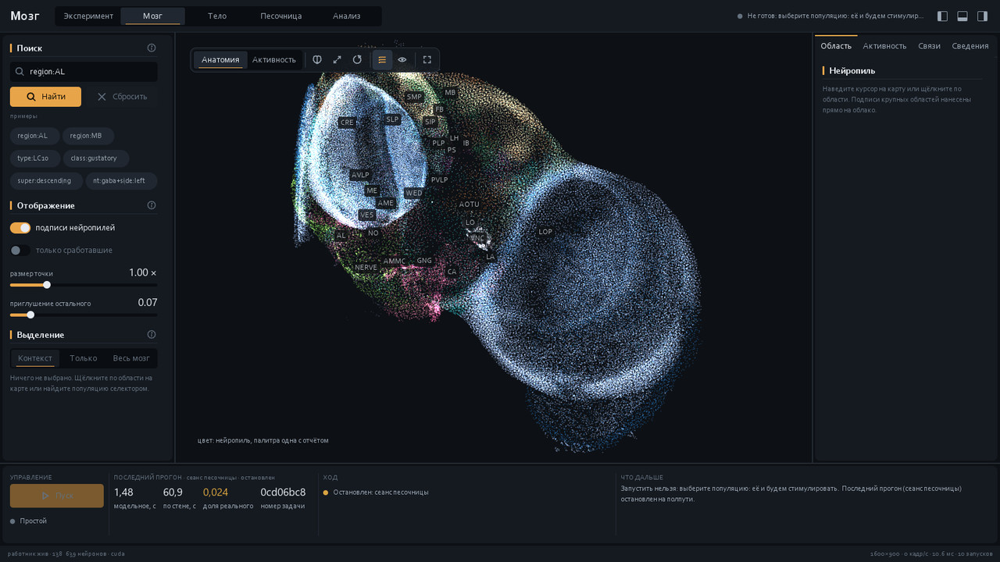
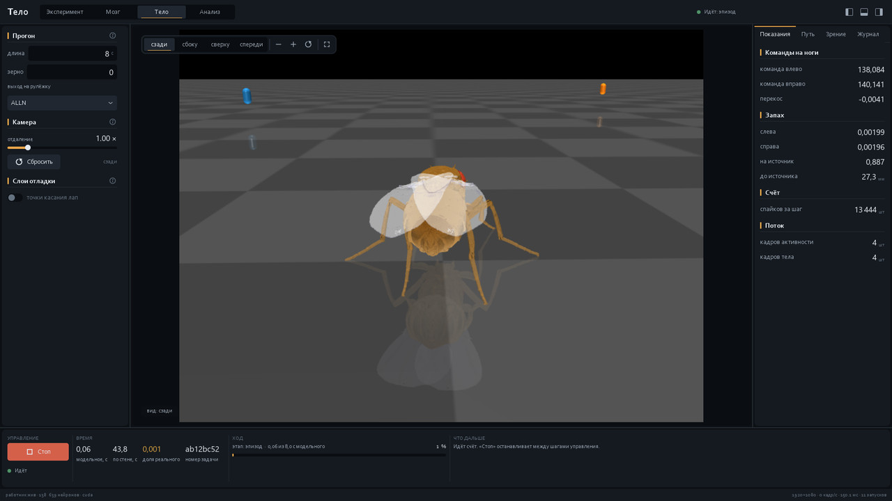

# fly-brain

Мозг дрозофилы по коннектому FlyWire v783 — **138 639 нейронов и
15 091 983 синаптические связи** — считается целиком на видеокарте, а
рядом стоит лаборатория, в которой на нём ставят опыты: окно с 3D-картой
мозга, тело NeuroMechFly v2 в MuJoCo, запах и зрение на настоящие
сенсорные нейроны, отчёты и агент на локальной модели.



*Рабочее пространство «Мозг»: облако из всех сом, раскрашенное по
36 нейропилям. Подписи висят на медиане сом своего нейропиля. Снимок
настоящего окна, не макет.*

## Что это на самом деле

Коннектом — полный. Модель — простая, и об этом сказано прямо, потому что
разница тут важнее красивых слов.

**Настоящее:** вся реконструкция FlyWire v783, то есть каждый нейрон мозга
взрослой мухи и каждая химическая связь, найденная при трассировке
ЭМ-объёма FAFB. Динамика — leaky integrate-and-fire с шагом 0,1 мс, те же
уравнения и параметры, что у Shiu et al., Nature 2024; сверка с апстримным
бэкендом даёт корреляцию 0,99.

**Упрощения:** нейрон — точка без дендритного дерева; вес связи — число
синапсов на 0,275 мВ, одинаково для всех; знак взят из предсказанного
нейромедиатора (точность предсказания около 87 %); нейромодуляции и
пластичности нет вовсе; грудного ганглия (VNC) нет — исполнители ходьбы и
полёта лежат в нём, а в этих данных его не существует.

Поэтому это не «муха в компьютере», а её проводка с простейшей физикой
проведения сигнала. Что на ней получается, а что нет — измерено и записано
числами, а не обещано.



*Рабочее пространство «Тело»: мозг ведёт муху по арене, справа — команды
на ноги, концентрация запаха у каждой антенны и число спайков за шаг.*

## Что умеет

Одно нативное окно (Taichi/Vulkan, без браузера и без Qt) с пятью
пространствами:

| | |
|---|---|
| **Эксперимент** | сборка прогона: кого зажечь, чем, как долго, что заглушить |
| **Мозг** | 3D-карта всех сом, живая активность по ходу счёта, связи, поиск по типам |
| **Тело** | NeuroMechFly v2 в MuJoCo: муха на арене, вид с четырёх камер, путь |
| **Песочница** | интерактивный сеанс: менять стимул и вмешательства прямо на ходу |
| **Анализ** | сохранённые прогоны, графики, таблицы, сравнение серий |

То же самое доступно из командной строки (`fly run`, `fly arena`,
`fly body`, `fly lateral`, `fly agent`, ещё десяток команд) и ложится в
самодостаточный HTML-отчёт с WebGL-облаком мозга.

Сенсорный вход настоящий: запах считается у каждой антенны и подаётся
Пуассоном на 1116 обонятельных нейронов слева и 1133 справа, вкус — на
410 вкусовых, кадр обоих сложных глаз — на **10 582 фоторецептора**
(721 омматидий на глаз).

## Что замерено

| | |
|---|---:|
| регрессия на выпуске этапа 2 | **27 проб из 27** |
| сохранённых научных прогонов | 28 |
| наведение на запах через ALPN (16 эпизодов на условие) | +0,142 против −0,035 у контроля, p = 0,006 |
| заглушение `DNp01` при нависающем объекте | путь короче на **26,0 %** на 6 зёрнах из 6 |
| доля реального времени, полный контур со зрением | **0,0774×** |

Про последние две строки надо сказать прямо, иначе выйдет подлог:

* **26 % — это следствие объявленного инженерного интерфейса, а не
  восстановленный естественный побег.** Путь «сцена → LC4/LPLC2 → DNp01»
  посчитан настоящими связями FlyWire, а вот связь `DNp01` → тело задана
  множителем амплитуды и по умолчанию выключена: в v783 у `DNp01` ноль пар
  из 110 с мотонейронами, потому что исполнители побега лежат в VNC.
* **Реального времени нет**, и до него далеко: один счёт MuJoCo занимает
  87,72 мс против всего бюджета в 20 мс. Это назван потолок, а не отложен.

Отдельно: прогон **со зрением** не воспроизводится побитово в новом
процессе — первая расходящаяся ступень найдена замером, это сырые пиксели
рендера на нулевом шаге. Для этого сделана запись сенсорной ленты, которая
воспроизводится побитово. Все 28 сохранённых прогонов посчитаны без зрения.

Полная приёмка со всеми числами и со всеми оговорками —
[lab/flybrain/FULL_LOOP_VALIDATION.md](lab/flybrain/FULL_LOOP_VALIDATION.md)
(около 2000 строк), итог этапа — [lab/flybrain/V2.md](lab/flybrain/V2.md).

## Запуск

Нужны Windows, видеокарта NVIDIA и Python 3.12.

```bash
git clone https://github.com/R1ens/fly-brain.git
cd fly-brain
uv venv --python 3.12 .venv
uv pip install --index-url https://download.pytorch.org/whl/cu128 torch
uv pip install -r requirements.lock
```

Коннектом (около четырёх гигабайт) в репозиторий не кладётся и скачивается
отдельно — [docs/HANDBOOK.md](docs/HANDBOOK.md) описывает, откуда и чем.
Дальше:

```bash
fly.cmd doctor        # всё ли на месте: окружение, данные, GPU
app.cmd               # окно
fly.cmd demos         # пять готовых опытов, пара минут
```

## Устройство

```
lab/flybrain/     ядро: sim, data, world, body, vision, retina, ipc, worker
lab/flybrain/ui/  окно: свои ядра растеризации, виджеты, пять пространств
lab/probe/        пробы: каждое утверждение в приёмке стоит за одной из них
launcher/         тонкий exe-пускатель
docs/HANDBOOK.md  подробный справочник: язык запросов, все команды, арена
```

Данные (`cache/`, `upstream/`), результаты (`out/`) и собранные exe
(`release/`) в историю не попадают: они принадлежат машине, а не коду.

## Лицензия и источники

Код в `lab/` повторяет уравнения и параметры апстрима
([eonsystemspbc/fly-brain](https://github.com/eonsystemspbc/fly-brain),
GPL-2.0-or-later), поэтому раздаётся на тех же условиях — см.
[LICENSE](LICENSE). Коннектом FlyWire и аннотации — CC-BY-4.0.

* Dorkenwald et al., *Neuronal wiring diagram of an adult brain*, Nature 2024
* Shiu et al., *A leaky integrate-and-fire computational model based on the
  connectome of the entire adult Drosophila brain*, Nature 2024
* Schlegel et al., *Whole-brain annotation and multi-connectome cell typing*,
  Nature 2024
* Lobato-Rios et al., *NeuroMechFly, a neuromechanical model of adult
  Drosophila melanogaster*, Nature Methods 2022
